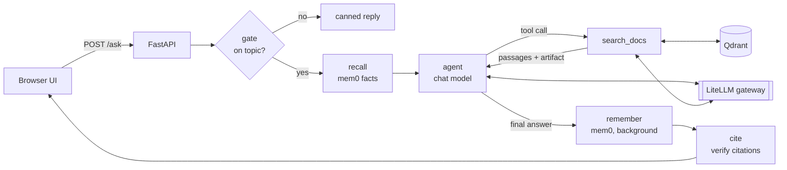

# citewise

**An agentic RAG template that cites its sources — and checks them.**
Drop in any documents, ask questions in a ChatGPT-style UI, and get answers where every claim links to the exact
passage it came from. Citations that don't match a retrieved passage are flagged instead of shown as fact.

**English** · [Türkçe](README.tr.md)


## Features

- **Agentic retrieval** — a LangGraph agent decides whether to search, with which query, and how many times.
- **Verified citations** — every `[source]` in an answer is matched against the passages the tool actually returned
  in that conversation; matches become numbered links, anything else is marked `[?]` with a warning.
- **Source viewer** — each citation opens the full document with the quoted passage highlighted (chunks are exact
  character slices of the original, so highlighting is precise).
- **Relevance gate** — a cheap yes/no model call stops off-topic questions before search, the agent and memory run;
  it can be swapped for a dedicated decision model such as Jev (see below).
- **Two memory layers** — per-conversation history with automatic compaction (old turns are summarised in the
  background), plus long-term per-user memory with mem0 that carries across conversations.
- **Fully async, non-blocking chats** — several conversations generate in parallel; the sidebar shows pending and
  unread chats; leaving for a source page and coming back resumes where you were, even mid-answer.
- **Model-agnostic** — the app only knows two aliases, `chat` and `embedding`. Swap providers in `litellm.yaml`
  (DeepSeek, OpenAI, Anthropic, Gemini, local Ollama, …) without touching code.
- **Small and readable** — about 800 lines of Python, no frontend build step, `msgspec` instead of pydantic for the API.

## Tech stack

| Layer | Choice | Why |
| --- | --- | --- |
| Agent orchestration | [LangGraph](https://github.com/langchain-ai/langgraph) | Explicit state graph, tool loop, async SQLite checkpointer |
| Vector database | [Qdrant](https://qdrant.tech) | Fast cosine search; also stores full documents (vector-less collection) |
| Model gateway | [LiteLLM](https://github.com/BerriAI/litellm) proxy | One OpenAI-compatible endpoint for every model; providers swap in config |
| Chat model (default) | DeepSeek (`deepseek-flash`) | Strong tool calling at low cost; replace with any LiteLLM model |
| Embeddings (default) | [Qwen3-Embedding-0.6B](https://huggingface.co/Qwen/Qwen3-Embedding-0.6B) via [Ollama](https://ollama.com) | Small multilingual model that runs locally |
| Long-term memory | [mem0](https://github.com/mem0ai/mem0) | Extracts and merges durable facts about each user |
| API | [FastAPI](https://fastapi.tiangolo.com) + [msgspec](https://jcristharif.com/msgspec/) | Async endpoints, fast strict validation |
| Chat history | SQLite | Zero-ops storage for conversations and checkpoints |
| UI | Plain HTML/CSS/JS + marked + DOMPurify | No build step; sanitised markdown; light/dark theme |
| Tooling | [uv](https://docs.astral.sh/uv/), [ruff](https://docs.astral.sh/ruff/), Docker Compose | Reproducible env, lint/format, one-command infrastructure |

## How it works



1. **Gate** — the gate model sees the last few messages and returns `{"relevant": true|false}`. Off-topic questions
   get a fixed reply and cost one small call.
2. **Recall** — mem0 returns what it knows about this user (name, role, preferences) for the system prompt.
3. **Agent ⇄ tools** — the agent calls `search_docs` as often as it needs. The tool sends text to the model and keeps
   the raw hits (source, offsets, score) as a LangChain *artifact* on the tool message.
4. **Remember** — the question and answer go to mem0 in a background task, so the answer isn't delayed.
5. **Cite** — `app/citations.py` matches each `[source]` in the answer against the artifacts still in the thread,
   numbers the matches, and lists the rest as unverified.
6. **Tidy** — after the response, a background task compacts long histories (keeps the last 2 turns verbatim,
   summarises the rest) and prunes old checkpoints. A new question on the same chat waits for it.

This verifies *that a cited document was really retrieved*, not that each sentence is entailed by it; claim-level
checking (an NLI or LLM-judge pass) is a natural next step.

## Quickstart

**Prerequisites:** Docker, [uv](https://docs.astral.sh/uv/getting-started/installation/),
[Ollama](https://ollama.com/download), and a [DeepSeek API key](https://platform.deepseek.com)
(or switch the `chat` alias to a local model, see below).

```bash
git clone https://github.com/mustafacavusoglu/citewise.git
cd citewise

ollama pull qwen3-embedding:0.6b
cp .env.example .env          # fill in LITELLM_MASTER_KEY, INGEST_KEY, DEEPSEEK_API_KEY
docker compose up -d          # Qdrant + LiteLLM, bound to 127.0.0.1
uv sync
uv run --env-file .env uvicorn app.main:app --port 8000
```

In a second terminal, index the bundled sample (a fictional company handbook) and open http://localhost:8000:

```bash
uv run --env-file .env python -m scripts.ingest data/sample
```

Try: *"How many vacation days do new employees get?"* or *"What should I do if my laptop is lost or stolen?"*

## Use your own documents

1. Put `.md`, `.txt` or `.json` files in a folder and run `uv run --env-file .env python -m scripts.ingest <folder>`.
   The relative path becomes the source name the agent cites; the first `# heading` becomes the title.
   A `.json` file is sent as-is and can carry any metadata:
   ```json
   {"source": "contracts/acme-2026.md", "text": "…", "metadata": {"title": "Acme MSA", "signed": "2026-03-01"}}
   ```
   Re-ingesting the same `source` overwrites it (ids are derived from the source name).
2. Set `KB_TOPIC` in `.env` to one line describing the documents — the gate and the system prompt use it.
3. Edit the four example questions in `app/static/index.html`.
4. To remove the sample data, delete the Qdrant volume: `docker compose down -v`.

**Swap models** — edit `litellm.yaml`, keep the aliases:

```yaml
- model_name: chat
  litellm_params:
    model: ollama_chat/qwen3:8b            # fully local; or openai/gpt-…, anthropic/claude-…, gemini/…
    api_base: http://host.docker.internal:11434
```

If you change the embedding model, set `EMBED_DIM` to its vector size, set `EMBED_QUERY_PREFIX` (empty for models
that don't use an instruction prefix), and re-ingest.

## Long-term memory (mem0)

Nothing extra to install or sign up for: citewise runs the open-source `mem0ai` package in-process, not the hosted
mem0 platform, so there is no mem0 API key.

- It uses the same LiteLLM gateway (`chat` to extract facts, `embedding` to index them) and the same Qdrant server,
  where it creates a `memories` collection on first start.
- Its change log (`history.db`) and `config.json` are written to `.mem0/` in the project (`MEM0_DIR` moves them);
  telemetry is turned off.
- The chat model must support JSON output (`response_format: json_object`). DeepSeek, OpenAI and Anthropic models
  through LiteLLM and most Ollama models do.
- It is told to keep only facts about the user (name, role, preferences, goals), not document content — see
  `custom_instructions` in `app/memory.py`.
- Writes run in the background after each answer, so a new memory can take a few seconds to show up in
  `GET /memories/{user}`.

## Using a dedicated decision model (e.g. Jev)

The relevance gate is one small function, `gate()` in `app/agent.py`. By default it asks the `GATE_MODEL` alias for
`{"relevant": true|false}` in JSON mode, so any chat model in `litellm.yaml` works; pointing `GATE_MODEL` at a
cheaper, faster alias is the easy way to cut cost.

Decision models such as [TypeSafe's Jev](https://arize.com/blog/typesafe-jev-llm-judge/) are built for exactly this
kind of yes/no step: instead of generating text, they return a probability for each answer you define. Their APIs are
usually not OpenAI-compatible (LiteLLM reaches Jev through a
[pass-through route](https://docs.litellm.ai/docs/pass_through/typesafe)), so replace the body of `gate()` instead of
the alias:

```python
async def gate(state: State) -> dict:
    recent = [m for m in state["messages"] if m.type in ("human", "ai") and m.content][-5:]
    transcript = "\n".join(f"{m.type}: {m.content[:300]}" for m in recent)
    try:
        scores = await decide(transcript, choices=["relevant", "off-topic"])  # your decision-model client
        relevant = scores["relevant"] >= 0.5  # tune the threshold on real questions
    except Exception:
        log.exception("gate failed; treating the question as relevant")
        relevant = True
    return {"relevant": relevant}
```

Keep the fail-open `except`: the gate saves cost, it is not a security control. Nothing else in the graph changes.
Independent benchmarks of decision models are mixed, so compare latency and accuracy on your own questions first.

## Configuration

| Variable | Default | Purpose |
| --- | --- | --- |
| `LITELLM_MASTER_KEY` | — (required) | Shared secret between the app and the gateway |
| `INGEST_KEY` | — | Bearer token for `POST /ingest`; empty keeps ingestion closed |
| `DEEPSEEK_API_KEY` | — | Provider key used by `litellm.yaml` |
| `KB_TOPIC` | Northwind Labs handbook | One-line description of the knowledge base |
| `CHAT_MODEL` / `GATE_MODEL` | `chat` / `chat` | Gateway aliases for the agent and the gate |
| `EMBED_MODEL` / `EMBED_DIM` | `embedding` / `1024` | Embedding alias and vector size |
| `EMBED_QUERY_PREFIX` | Qwen3 instruction | Prepended to search queries only |
| `LITELLM_URL` / `QDRANT_URL` | `localhost:4000` / `localhost:6333` | Service locations |
| `DB_PATH` | `app.db` | SQLite file for chat history and checkpoints |
| `MEM0_DIR` | `.mem0` | mem0's local history database and config file |

Chunk size, top-k and compaction thresholds are constants in `app/config.py`.

## API

| Method | Path | Description |
| --- | --- | --- |
| `POST` | `/ask` | `{question, user_id, thread_id?}` → `{answer, sources, unverified, thread_id, relevant}`; `409` if that chat is already answering |
| `POST` | `/ingest` | `{text, source, metadata?}` with `Authorization: Bearer $INGEST_KEY` → `{chunks}` |
| `GET` | `/search?q=&k=` | Retrieval only, no LLM — useful for tuning chunking |
| `GET` | `/documents/{doc_id}` | Full text and metadata of a source |
| `GET` | `/users/{user}/conversations` | Conversation list (`pending` while answering) |
| `GET` | `/users/{user}/conversations/{id}` | Messages with their sources |
| `GET` | `/users/{user}/conversations/{id}/state` | Agent-side state: compaction summary and kept messages |
| `GET` | `/memories/{user}` | What mem0 remembers about a user |

## Project structure

```
app/
  main.py         FastAPI app, lifespan, endpoints, background compaction/pruning
  agent.py        LangGraph graph: gate → recall → agent ⇄ tools → remember; prompts; compaction
  citations.py    citation matching and numbering (with a self-check)
  chunking.py     sentence-based chunking with character offsets (with a self-check)
  vectorstore.py  Qdrant: chunk vectors + full documents
  memory.py       mem0 long-term memory on the same gateway and Qdrant
  llm.py          chat and embedding clients for the gateway
  history.py      SQLite chat history for the UI
  config.py       settings from environment variables
  static/         chat page, source page, shared theme
scripts/ingest.py index a folder through POST /ingest
data/sample/      fictional employee handbook used by the demo
litellm.yaml      model aliases → providers
docker-compose.yml Qdrant + LiteLLM
```

## Development

```bash
uv run python -m app.chunking      # self-checks
uv run python -m app.citations
uvx ruff check . && uvx ruff format --check .
```

## Limitations

- **Login is not authentication.** The username only separates chat lists and memory; anyone who knows a name can
  read that user's chats and memories. Put real auth in front before exposing it beyond localhost.
- **Single process.** In-flight state (`active`, background tasks) lives in memory; run one uvicorn worker.
- A background mem0 write still running at shutdown is lost.
- The regex sentence splitter can break on abbreviations ("Dr. Smith"); swap in pysbd/nltk if that matters.
- Reasoning models may reject a forced `tool_choice`, so the gate uses JSON mode.

## License

[MIT](LICENSE)
