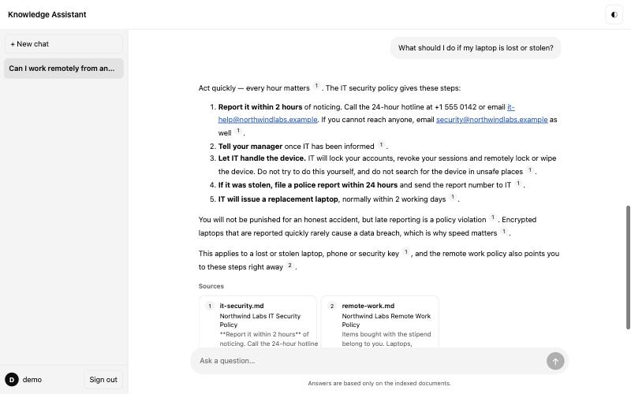
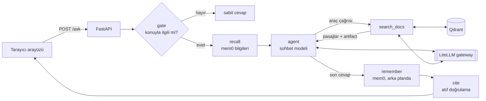

# citewise

**Kaynağını gösteren ve atıflarını doğrulayan agentic RAG şablonu.**
İstediğin belgeleri yükle, ChatGPT benzeri arayüzden soru sor; her bilginin hangi pasajdan geldiğini gösteren
cevaplar al. Getirilen bir pasajla eşleşmeyen atıflar gerçekmiş gibi gösterilmez, işaretlenir.

[English](README.md) · **Türkçe**



## Özellikler

- **Agentic arama** — LangGraph agent'ı aramaya gerek olup olmadığına, hangi sorguyla ve kaç kez arayacağına kendisi
  karar verir.
- **Doğrulanan atıflar** — cevaptaki her `[kaynak]`, o sohbette aracın gerçekten getirdiği pasajlarla karşılaştırılır;
  eşleşenler numaralı linke dönüşür, eşleşmeyenler `[?]` ve uyarıyla gösterilir.
- **Kaynak görüntüleyici** — her atıf belgenin tamamını açar ve alıntılanan pasajı vurgular (parçalar orijinal metnin
  birebir karakter dilimleri olduğu için vurgu tam yerine oturur).
- **İlgi kapısı (gate)** — ucuz bir evet/hayır model çağrısı, konu dışı soruları arama, agent ve hafıza çalışmadan
  durdurur; istenirse Jev ya da açık kaynak Clef gibi özel bir karar modeliyle değiştirilebilir (aşağıya bak).
- **İki katmanlı hafıza** — sohbet geçmişi otomatik sıkıştırılır (eski turlar arka planda özetlenir); mem0 ile
  kullanıcı başına uzun vadeli hafıza sohbetler arasında taşınır.
- **Tamamen async, birbirini beklemeyen sohbetler** — birden çok sohbet paralel cevaplanır; kenar çubuğu bekleyen ve
  okunmamış sohbetleri gösterir; kaynak sayfasına gidip dönünce, cevap üretilirken bile kaldığın yerden devam edersin.
- **Modelden bağımsız** — uygulama yalnızca `chat` ve `embedding` takma adlarını bilir. Sağlayıcıyı `litellm.yaml`'da
  değiştirirsin (DeepSeek, OpenAI, Anthropic, Gemini, yerel Ollama…), kod değişmez.
- **Küçük ve okunur** — yaklaşık 800 satır Python, frontend derleme adımı yok, API'de pydantic yerine `msgspec`.

## Kullanılan teknolojiler

| Katman | Seçim | Neden |
| --- | --- | --- |
| Agent orkestrasyonu | [LangGraph](https://github.com/langchain-ai/langgraph) | Açık state grafı, araç döngüsü, async SQLite checkpointer |
| Vektör veritabanı | [Qdrant](https://qdrant.tech) | Hızlı cosine arama; tam metinleri de saklar (vektörsüz koleksiyon) |
| Model gateway | [LiteLLM](https://github.com/BerriAI/litellm) proxy | Tüm modeller için tek OpenAI uyumlu uç; sağlayıcı ayardan değişir |
| Sohbet modeli (varsayılan) | DeepSeek (`deepseek-flash`) | Düşük maliyetle güçlü tool calling; herhangi bir LiteLLM modeliyle değişir |
| Embedding (varsayılan) | [Ollama](https://ollama.com) üzerinden [Qwen3-Embedding-0.6B](https://huggingface.co/Qwen/Qwen3-Embedding-0.6B) | Yerelde çalışan küçük, çok dilli model |
| İlgi kapısı (isteğe bağlı) | [Clef / Clef-flash](https://huggingface.co/Cloudflare/clef-flash) | Açık ağırlıklı (Apache-2.0) karar modelleri, Jev uyumlu API |
| Uzun vadeli hafıza | [mem0](https://github.com/mem0ai/mem0) | Her kullanıcı hakkındaki kalıcı bilgileri çıkarır ve birleştirir |
| API | [FastAPI](https://fastapi.tiangolo.com) + [msgspec](https://jcristharif.com/msgspec/) | Async uçlar, hızlı ve katı doğrulama |
| Sohbet geçmişi | SQLite | Sohbetler ve checkpoint'ler için bakım gerektirmeyen depolama |
| Arayüz | Düz HTML/CSS/JS + marked + DOMPurify | Derleme yok; temizlenmiş markdown; açık/koyu tema |
| Araçlar | [uv](https://docs.astral.sh/uv/), [ruff](https://docs.astral.sh/ruff/), Docker Compose | Tekrarlanabilir ortam, lint/format, tek komutla altyapı |

## Nasıl çalışır



1. **Gate** — kapı modeli son birkaç mesajı görür ve `{"relevant": true|false}` döner. Konu dışı sorular sabit bir
   cevap alır ve yalnızca bir küçük çağrıya mal olur.
2. **Recall** — mem0 bu kullanıcı hakkında bildiklerini (ad, rol, tercihler) system prompt'a ekler.
3. **Agent ⇄ araçlar** — agent `search_docs`'u gerektiği kadar çağırır. Araç modele metni gönderir, ham sonuçları
   (kaynak, konum, skor) ise araç mesajında LangChain *artifact*'ı olarak tutar.
4. **Remember** — soru ve cevap arka planda mem0'a gider, cevap gecikmez.
5. **Cite** — `app/citations.py` cevaptaki her `[kaynak]`'ı sohbette duran artifact'larla eşler, eşleşenleri
   numaralandırır, kalanları doğrulanamayan olarak listeler.
6. **Toparlama** — cevaptan sonra arka plandaki bir görev uzun geçmişi sıkıştırır (son 2 tur aynen kalır, gerisi
   özetlenir) ve eski checkpoint'leri siler. Aynı sohbete gelen yeni soru bunun bitmesini bekler.

Bu, *atıf yapılan belgenin gerçekten getirildiğini* doğrular; her cümlenin o belgede geçtiğini değil. Cümle
düzeyinde kontrol (NLI ya da LLM-hakem) doğal bir sonraki adım.

## Hızlı başlangıç

**Gerekenler:** Docker, [uv](https://docs.astral.sh/uv/getting-started/installation/),
[Ollama](https://ollama.com/download) ve bir [DeepSeek API anahtarı](https://platform.deepseek.com)
(ya da `chat` takma adını yerel bir modele çevir, aşağıya bak).

```bash
git clone https://github.com/mustafacavusoglu/citewise.git
cd citewise

ollama pull qwen3-embedding:0.6b
cp .env.example .env          # LITELLM_MASTER_KEY, INGEST_KEY, DEEPSEEK_API_KEY değerlerini doldur
docker compose up -d          # Qdrant + LiteLLM, yalnızca 127.0.0.1'de
uv sync
uv run --env-file .env uvicorn app.main:app --port 8000
```

İkinci bir terminalde örnek veriyi (kurgusal bir şirketin çalışan el kitabı) yükle ve http://localhost:8000 adresini aç:

```bash
uv run --env-file .env python -m scripts.ingest data/sample
```

Dene: *"How many vacation days do new employees get?"* ya da Türkçe *"Yeni çalışanlar kaç gün izin alıyor?"* —
agent kullanıcının dilinde cevap verir.

## Kendi belgelerinle kullan

1. `.md`, `.txt` ya da `.json` dosyalarını bir klasöre koy ve
   `uv run --env-file .env python -m scripts.ingest <klasör>` çalıştır. Göreli dosya yolu agent'ın atıf yaptığı kaynak
   adı olur; ilk `# başlık` da başlık olur. `.json` dosyası olduğu gibi gönderilir ve istediğin metadata'yı taşıyabilir:
   ```json
   {"source": "sozlesmeler/acme-2026.md", "text": "…", "metadata": {"title": "Acme Sözleşmesi", "imza": "2026-03-01"}}
   ```
   Aynı `source` tekrar yüklenirse üzerine yazılır (kimlikler kaynak adından türetilir).
2. `.env` içinde `KB_TOPIC`'i belgeleri anlatan tek bir satıra çevir — kapı ve system prompt bunu kullanır.
3. `app/static/index.html` içindeki dört örnek soruyu düzenle.
4. Örnek veriyi silmek için Qdrant volume'ünü sil: `docker compose down -v`.

**Modeli değiştir** — `litellm.yaml`'ı düzenle, takma adları koru:

```yaml
- model_name: chat
  litellm_params:
    model: ollama_chat/qwen3:8b            # tamamen yerel; ya da openai/gpt-…, anthropic/claude-…, gemini/…
    api_base: http://host.docker.internal:11434
```

Embedding modelini değiştirirsen `EMBED_DIM`'i yeni vektör boyutuna, `EMBED_QUERY_PREFIX`'i de modele göre ayarla
(talimat öneki kullanmayan modellerde boş bırak) ve belgeleri yeniden yükle.

## Uzun vadeli hafıza (mem0)

Ayrıca kurulacak ya da kayıt olunacak bir şey yok: citewise, barındırılan mem0 platformunu değil açık kaynak `mem0ai`
paketini uygulamanın içinde çalıştırır; mem0 API anahtarı gerekmez.

- Aynı LiteLLM gateway'ini (bilgi çıkarmak için `chat`, indekslemek için `embedding`) ve aynı Qdrant sunucusunu
  kullanır; ilk açılışta `memories` koleksiyonunu kendisi oluşturur.
- Değişiklik kaydı (`history.db`) ve `config.json` proje içindeki `.mem0/` klasörüne yazılır (`MEM0_DIR` ile
  taşınabilir); telemetri kapalıdır.
- Sohbet modeli JSON çıktısını (`response_format: json_object`) desteklemelidir. LiteLLM üzerinden DeepSeek, OpenAI,
  Anthropic modelleri ve çoğu Ollama modeli destekler.
- Yalnızca kullanıcıya dair bilgileri (ad, rol, tercihler, hedefler) tutması, belge içeriğini tutmaması söylenir —
  `app/memory.py` içindeki `custom_instructions`'a bak.
- Kayıtlar her cevaptan sonra arka planda yapılır; yeni bir bilginin `GET /memories/{user}`'da görünmesi birkaç saniye
  sürebilir.

## Özel bir karar modeli kullanmak (Jev, Clef)

İlgi kapısı tek bir küçük fonksiyondur: `app/agent.py` içindeki `gate()`. Varsayılan olarak `GATE_MODEL` takma adına
JSON modunda `{"relevant": true|false}` sorar; yani `litellm.yaml`'daki her sohbet modeli çalışır. Maliyeti düşürmenin
kolay yolu `GATE_MODEL`'i daha ucuz ve hızlı bir takma ada yönlendirmektir.

[TypeSafe'in Jev'i](https://arize.com/blog/typesafe-jev-llm-judge/) gibi karar modelleri tam bu tür evet/hayır
adımları için yapılmıştır: metin üretmek yerine, senin tanımladığın her cevap için bir olasılık döndürürler. API'leri
genellikle OpenAI uyumlu değildir (LiteLLM Jev'e
[pass-through yolu](https://docs.litellm.ai/docs/pass_through/typesafe) ile ulaşır); bu yüzden takma adı değil
`gate()`'in gövdesini değiştir:

```python
async def gate(state: State) -> dict:
    recent = [m for m in state["messages"] if m.type in ("human", "ai") and m.content][-5:]
    transcript = "\n".join(f"{m.type}: {m.content[:300]}" for m in recent)
    try:
        scores = await decide(transcript, choices=["relevant", "off-topic"])  # karar modeli istemcin
        relevant = scores["relevant"] >= 0.5  # eşiği gerçek sorularla ayarla
    except Exception:
        log.exception("gate failed; treating the question as relevant")
        relevant = True
    return {"relevant": relevant}
```

Hata durumunda soruyu geçiren `except`'i koru: kapı maliyet içindir, güvenlik önlemi değildir. Grafın geri kalanı
değişmez. Karar modelleriyle ilgili bağımsız karşılaştırmaların sonuçları karışık; geçmeden önce gecikmeyi ve
doğruluğu kendi sorularınla ölç.

### Önerilen açık kaynak seçenek: Cloudflare Clef

[Clef](https://huggingface.co/Cloudflare/clef) (27B) ve [Clef-flash](https://huggingface.co/Cloudflare/clef-flash)
(9B), Cloudflare'in Apache-2.0 lisanslı, Qwen3.5 üzerine eğitilmiş açık ağırlıklı karar modelleridir. Bir durum ve
tipli sorular alırlar, tek seferde her seçenek için olasılık döndürürler. API'leri Jev'in `POST /v1/systemone`'ıyla
uyumludur; yani `gate()` kodu Jev'i de çağırsan, Clef'i kendin de çalıştırsan aynı kalır.

SGLang ile kendin çalıştırabilirsin (model kartındaki komut, NVIDIA GPU gerekir) ya da Cloudflare Workers AI'daki
barındırılan sürümü kullanabilirsin:

```bash
docker run --gpus all --shm-size 32g --ipc=host -p 127.0.0.1:30000:30000 \
  -v ~/.cache/huggingface:/root/.cache/huggingface \
  lmsysorg/sglang:dev-clef sglang serve --model-path Cloudflare/clef-flash --host 0.0.0.0 --port 30000
```

İlgi kontrolü tek bir doğru/yanlış (`noul`) sorusudur:

```bash
curl http://localhost:30000/v1/systemone -H 'Content-Type: application/json' -d '{
  "model": "Cloudflare/clef-flash",
  "state": "human: What is the hotel limit for business travel?",
  "questions": {"relevant": {"type": "noul",
    "instructions": "Could this be answered from the Northwind Labs employee handbook, or is it a follow-up to such a question?"}}
}'
```

`answers` içinden `relevant` için `true` olasılığını oku ve `gate()` içinde eşiğinle karşılaştır.
Hangi boyut: kapı aslında bir "kapsam dışı mı?" kontrolüdür. Cloudflare'in kendi bildirdiği Decision Index
ölçümünde CLINC150+OOS'ta Clef 97.4, Clef-flash 66.8 almış. Doğruluk gecikmeden önemliyse Clef ile başla ve ikisini de
kendi sorularınla ölç.

## Ayarlar

| Değişken | Varsayılan | Amaç |
| --- | --- | --- |
| `LITELLM_MASTER_KEY` | — (zorunlu) | Uygulama ile gateway arasındaki ortak anahtar |
| `INGEST_KEY` | — | `POST /ingest` için Bearer anahtarı; boşsa yükleme kapalı |
| `DEEPSEEK_API_KEY` | — | `litellm.yaml`'ın kullandığı sağlayıcı anahtarı |
| `KB_TOPIC` | Northwind Labs el kitabı | Bilgi tabanının tek satırlık tanımı |
| `CHAT_MODEL` / `GATE_MODEL` | `chat` / `chat` | Agent ve kapı için gateway takma adları |
| `EMBED_MODEL` / `EMBED_DIM` | `embedding` / `1024` | Embedding takma adı ve vektör boyutu |
| `EMBED_QUERY_PREFIX` | Qwen3 talimatı | Yalnızca arama sorgularının başına eklenir |
| `LITELLM_URL` / `QDRANT_URL` | `localhost:4000` / `localhost:6333` | Servis adresleri |
| `DB_PATH` | `app.db` | Sohbet geçmişi ve checkpoint'ler için SQLite dosyası |
| `MEM0_DIR` | `.mem0` | mem0'ın yerel geçmiş veritabanı ve ayar dosyası |

Parça boyutu, top-k ve sıkıştırma eşikleri `app/config.py` içinde sabittir.

## API

| Metot | Yol | Açıklama |
| --- | --- | --- |
| `POST` | `/ask` | `{question, user_id, thread_id?}` → `{answer, sources, unverified, thread_id, relevant}`; o sohbet zaten cevaplanıyorsa `409` |
| `POST` | `/ingest` | `Authorization: Bearer $INGEST_KEY` ile `{text, source, metadata?}` → `{chunks}` |
| `GET` | `/search?q=&k=` | Yalnızca arama, LLM yok — parçalamayı ayarlamak için |
| `GET` | `/documents/{doc_id}` | Bir kaynağın tam metni ve metadata'sı |
| `GET` | `/users/{user}/conversations` | Sohbet listesi (cevaplanırken `pending`) |
| `GET` | `/users/{user}/conversations/{id}` | Kaynaklarıyla birlikte mesajlar |
| `GET` | `/users/{user}/conversations/{id}/state` | Agent tarafındaki state: sıkıştırma özeti ve tutulan mesajlar |
| `GET` | `/memories/{user}` | mem0'ın kullanıcı hakkında hatırladıkları |

## Proje yapısı

```
app/
  main.py         FastAPI uygulaması, lifespan, uçlar, arka plan sıkıştırma/budama
  agent.py        LangGraph grafı: gate → recall → agent ⇄ tools → remember; istemler; sıkıştırma
  citations.py    atıf eşleme ve numaralandırma (kendi testiyle)
  chunking.py     karakter konumlu, cümle bazlı parçalama (kendi testiyle)
  vectorstore.py  Qdrant: parça vektörleri + tam belgeler
  memory.py       aynı gateway ve Qdrant üzerinde mem0 uzun vadeli hafıza
  llm.py          gateway için sohbet ve embedding istemcileri
  history.py      arayüz için SQLite sohbet geçmişi
  config.py       ortam değişkenlerinden ayarlar
  static/         sohbet sayfası, kaynak sayfası, ortak tema
scripts/ingest.py bir klasörü POST /ingest ile yükler
data/sample/      demoda kullanılan kurgusal çalışan el kitabı
litellm.yaml      takma adlar → sağlayıcılar
docker-compose.yml Qdrant + LiteLLM
```

## Geliştirme

```bash
uv run python -m app.chunking      # kendi testleri
uv run python -m app.citations
uvx ruff check . && uvx ruff format --check .
```

## Sınırlamalar

- **Giriş, kimlik doğrulama değildir.** Kullanıcı adı yalnızca sohbet listesini ve hafızayı ayırır; adı bilen herkes o
  kullanıcının sohbetlerini ve hafızasını okuyabilir. localhost dışına açmadan önce önüne gerçek bir kimlik doğrulama koy.
- **Tek süreç.** Devam eden işlerin durumu (`active`, arka plan görevleri) bellekte; tek uvicorn worker'ı çalıştır.
- Kapanış anında hâlâ süren bir mem0 yazımı kaybolur.
- Regex cümle bölücü kısaltmalarda ("Dr. Smith") yanlış bölebilir; önemliyse pysbd/nltk kullan.
- Akıl yürüten (reasoning) modeller zorunlu `tool_choice`'u reddedebildiği için kapı JSON modu kullanır.

## Lisans

[MIT](LICENSE)
